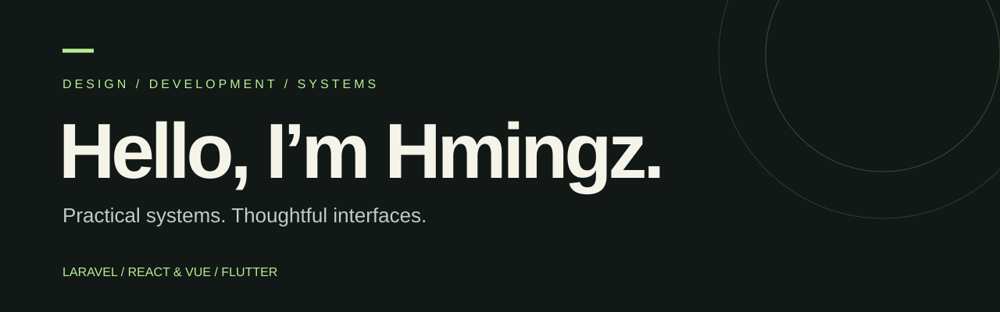

<picture>
  
</picture>

# Lalhmingliana Pachuau

**Full-stack developer building software around real operational work.**

I work across Laravel, React, Vue, and Flutter, connecting clear interfaces with the workflows behind them: inventory, academic operations, healthcare administration, commerce, and local-first tools.

[Explore my repositories](https://github.com/cloudshmingz17-art?tab=repositories) · [LinkedIn](https://www.linkedin.com/in/lalhmingliana-pachuau-189379272/) · [Get in touch](mailto:cloudshmingz17@gmail.com)

## Selected work

| Project | What I work on | Stack |
| --- | --- | --- |
| **Fone Inn** | Retail inventory, sales, finance, and storefront workflows | Laravel · React |
| **MIZOMIL** | Commerce administration, catalog management, and social publishing workflows | Laravel · React |
| **BN Nursing** | Academic administration, enrollment, and student document workflows | Laravel · React |
| **Greenwood** | Hospital administration and patient workflow tools | Laravel · React |
| **Factory management system** | Production, materials, orders, and finance workflows | Laravel |
| **Courier Service** | Local-first courier operations | Flutter · SQLite |

These summaries describe development work, not claims of production readiness. Source repositories for business and client projects are kept private. Public case studies can show the problem, interface, architecture, and my contribution without exposing operational records.

## How I build

- Start with the workflow and the people who use it.
- Design responsive interfaces with readable light and dark states.
- Keep business rules, permissions, and data integrity close to the backend.
- Verify locally and distinguish that from live deployment.

## Toolbox

**Backend:** PHP · Laravel · SQL  
**Web:** TypeScript · React · Vue · Inertia · Tailwind CSS  
**Mobile:** Dart · Flutter · SQLite

---

Have a system that needs a clearer interface or a more reliable workflow? [Let's talk](mailto:cloudshmingz17@gmail.com).
